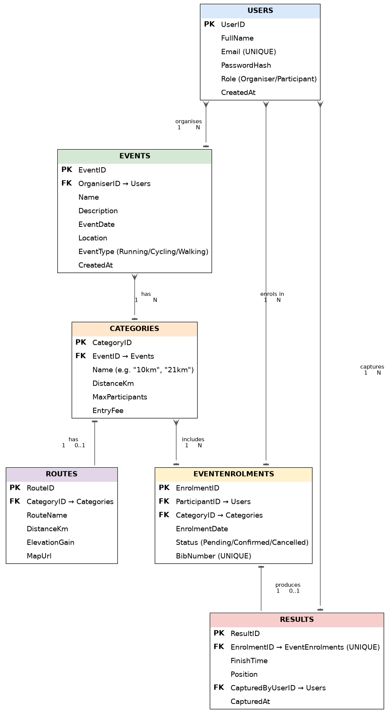

# RaceDay — Event Management System (Part 2: RESTful API)

**Student:** Matodzi Nevhutala (ST10485700)
**Module:** Portfolio of Evidence — Part 2: RESTful API Development

RaceDay is an event management system for South African road running, walking and cycling events. Part 2 is the RESTful API that powers the whole system: it stores data in SQL Server through Entity Framework Core (Code-First), enforces role-based access with session authentication, is fully documented in Swagger, and is covered by automated unit tests that run on every push through GitHub Actions.

## Links

| Item | Link |
|---|---|
| Part 2 code (branch) | https://github.com/ST10485700/event-management-system/tree/part-2-api |
| Part 2 video (unlisted YouTube) | [PASTE YOUR YOUTUBE LINK HERE](PASTE_LINK_HERE) |
| Endpoint documentation | [docs/Part2_Endpoint_Implementation.md](docs/Part2_Endpoint_Implementation.md) |

## The two roles

| Role | What they can do |
|---|---|
| **Organiser** | Create, edit and delete their own events; define categories (distance, limit, fee) and routes for their events; view all enrolments for their events; capture, correct and delete results for their events. |
| **Participant** | Register an account, log in, browse events, categories and routes, enter an event by choosing a category, view and cancel their own enrolments, and view their own results. |

Both roles can view and update their own profile. Organisers cannot use Participant-only endpoints (for example enrolling), and Participants cannot use Organiser-only endpoints (for example creating events). An Organiser can only manage events they own.

**How roles are assigned:** public registration always creates a **Participant**, whatever is sent in the request. Organiser accounts are created by the database seeder, so nobody can sign themselves up as an Organiser.

## Technology

- ASP.NET Core Web API (.NET 8)
- Entity Framework Core 8, **Code-First** with migrations
- SQL Server (LocalDB)
- BCrypt.Net-Next for password hashing
- ASP.NET Core sessions for authentication
- Swashbuckle (Swagger UI) with XML comments
- xUnit, `WebApplicationFactory` and the EF Core in-memory provider for tests
- GitHub Actions for CI

## Getting started

### Prerequisites

- Visual Studio 2022 with the ASP.NET workload, or the .NET 8 SDK
- SQL Server LocalDB (installed with Visual Studio)

### Run the API

1. Clone the repository and switch to the `part-2-api` branch:
   ```
   git clone https://github.com/ST10485700/event-management-system.git
   cd event-management-system
   git checkout part-2-api
   ```
2. Open `RaceDay_API.sln` in Visual Studio.
3. Check the connection string in `RaceDay_API/appsettings.json`. It is set up for the LocalDB instance `(localdb)\api_guide`. If your instance has a different name (for example `MSSQLLocalDB`), change it:
   ```json
   "ConnectionStrings": {
     "RaceDayConnection": "Server=(localdb)\\api_guide;Database=RaceDayDB;Trusted_Connection=True;TrustServerCertificate=True;"
   }
   ```
4. Set `RaceDay_API` as the startup project and press **F5** (or run `dotnet run --project RaceDay_API`).
5. On first start the API creates the `RaceDayDB` database from the EF Core migrations and seeds it with sample data. Swagger opens at `https://localhost:<port>/swagger` (the port is shown in the console).

### Seeded logins

All seeded accounts use the password **`Password123!`**.

| Email | Role |
|---|---|
| thabo@raceday.co.za | Organiser |
| lerato@raceday.co.za | Organiser |
| matodzi@raceday.co.za | Participant |
| uche@raceday.co.za | Participant |

### Try it in Swagger

1. Open `POST /api/Users/login`, click **Try it out**, enter an email and password in the text boxes, and click **Execute**. This starts a session, and Swagger keeps the session cookie.
2. Use any other endpoint. The API takes **form fields rather than JSON**, so every field has its own text box. Dates use `yyyy-MM-dd` (for example `2026-12-20`) and finish times use `hh:mm:ss` (for example `00:31:42`).
3. To switch role, call `POST /api/Users/logout` and log in as another user.

### Run the tests

Open **Test → Test Explorer** in Visual Studio and click **Run All Tests**, or run:
```
dotnet test RaceDay_API.sln
```

## Authentication and authorisation

- **Registration** (`POST /api/Users/register`) stores a BCrypt hash. The original password is never stored or returned.
- **Login** (`POST /api/Users/login`) checks the password and saves the user's ID and role in the session. The session cookie is HttpOnly and expires after 30 minutes of inactivity.
- **Role enforcement** uses a custom `[SessionAuthorize]` attribute (`Security/SessionAuthorizeAttribute.cs`). No session returns **401 Unauthorized**, and the wrong role returns **403 Forbidden**.
- **Ownership checks:** an Organiser can only edit or delete events, categories, routes and results that belong to their own events, and a Participant can only see and cancel their own enrolments. Breaking these rules also returns 403.

## Endpoints

The API has 31 endpoints in six areas. The full table (method, route, description, role, form fields and responses) is in [docs/Part2_Endpoint_Implementation.md](docs/Part2_Endpoint_Implementation.md), and every endpoint is visible and testable in Swagger.

| Area | Endpoints | Summary |
|---|---|---|
| Users | 5 | Register, log in, log out, view and update own profile |
| Events | 5 | List and view (any user); create, update, delete (Organiser) |
| Categories | 5 | List and view (any user); create, update, delete (Organiser) |
| Routes | 5 | List and view (any user); create, update, delete (Organiser) |
| Enrolments | 6 | Enrol, view own, cancel (Participant); view and remove for own events (Organiser) |
| Results | 5 | Capture, update, delete, list (Organiser); view own (Participant) |

## Project structure

```
RaceDay_API.sln
RaceDay_API/                  The API project
  Controllers/                Users, Events, Categories, Routes, Enrolments, Results
  Models/                     Entities, form DTOs and the database seeder
  Migrations/                 EF Core Code-First migrations
  Security/                   SessionAuthorizeAttribute (role enforcement)
  Program.cs                  Services, session, Swagger and startup
RaceDay_API.Tests/            xUnit test project
.github/workflows/            CI workflows
docs/                         Part 1 planning documents and Part 2 endpoint documentation
```

## Unit tests

The test project has **63 automated tests**. Each test starts the real API in memory (`WebApplicationFactory`) with an in-memory database, logs in through the real login endpoint, and sends real form requests, so authentication, sessions and role checks are tested exactly as they work in production. Tests create their own data, so they do not depend on the seeded dates.

| Area | What is tested |
|---|---|
| Registration and login | Valid registration, duplicate email, invalid email, short password, missing fields, a `role` field being ignored, valid and invalid login |
| Sessions and profile | Profile needs a session, profile view and update, email conflicts, logout ends the session |
| Event management | Organisers create, update and delete their own events; cannot touch another Organiser's event; past dates and invalid event types are rejected; Participants can view events |
| Role-based access | Every protected endpoint rejects a request with no session (401); Participants are rejected from Organiser actions and Organisers from Participant actions (403) |
| Enrolments | Participants enrol and get a bib number; the enrolment is recorded and visible to the Participant and the event's Organiser; duplicate, full, unknown and past-event enrolments are rejected; cancelling and viewing someone else's enrolment is rejected |
| Results | Organisers capture results and Participants see only their own; Participants and other Organisers are rejected; duplicate results are rejected |

## CI/CD

Two GitHub Actions workflows live in `.github/workflows/`:

- `build-and-test.yml` restores, builds and runs all unit tests on every push and pull request.
- `validate-docs.yml` (from Part 1) checks that the `docs` folder exists and contains the ERD, endpoint plan and SQL script.


## Differences from Part 1 and design decisions

| Topic | Part 1 | Part 2 and the reason |
|---|---|---|
| Primary keys | Hand-numbered integers | Auto-generated (identity) keys. An API that creates records needs the database to assign IDs. |
| Column types | `varchar`, `datetime` | `nvarchar`, `datetime2`, which are the defaults EF Core Code-First generates. |
| Database creation | SQL script | EF Core migrations create the schema, and a seeder fills it. The Part 1 script `RaceDayEvents.sql` in `docs` is kept as the plan. |
| Authentication routes | Separate Auth area | Authentication was merged into the Users controller (`/api/Users/register`, `/login`, `/logout`, `/profile`) on my lecturer's instruction. |
| Request bodies | JSON | Form fields, so each Swagger field has its own text box (my lecturer's instruction). |
| Extra endpoints | — | `/logout`, `/my` (own enrolments and results), `/{id}/cancel`, and `?eventId=` and `?categoryId=` filters. |
| Event distance | A distance on events | Distance belongs to each category (5 km, 10 km and so on), because one event offers several distances. |
| Organiser sign-up | — | Organisers are seeded and never self-registered. |

Other decisions: bib numbers are assigned by the server, enrolling in a past event is blocked, and an event or category cannot be deleted while it still has categories or enrolments.

## AI Tool Disclosure

AI tools (Claude) were used during Part 2 to guide the build and to help write and debug code: the Code-First models and migration, the controllers, the session authentication, the xUnit tests and the GitHub Actions workflow, as well as drafts of this documentation. I ran and tested everything myself, made the final decisions, and can explain and defend the code and design choices in the video.

---

*The Part 1 README is kept below.*

# event-management-system
ST10485700- POE PART 1

# RaceDay — Event Management System (Part 1: System Planning and Database)

## Description
RaceDay is a full-stack, web-based event management system built for the South African road running,
walking, and cycling community. Event Organisers can create and manage events, categories, and
participant results. Participants can browse upcoming events, enter events by selecting a category,
track their personal performance history, and prepare for race day using route information.

This repository currently contains the **Part 1** deliverables: the system plan and database.

## Roles
- **Organiser** — can create, edit, and delete events; manage event categories; capture participant
  results; and view all enrolments for their events.
- **Participant** — can create an account, browse events, enter an event by selecting a category, view
  their own enrolments, and track their own results.

## Part 1 Deliverables (in /docs)
- `RaceDay-ERD.png` — Entity Relationship Diagram, 6 entities: Users, Events, Categories, Routes,
  EventEnrolments, Results.
- `API_Endpoint_Plan.pdf` — full API endpoint plan (30 endpoints across Authentication, User Profile,
  Events, Categories, Event Enrolments, Results, and Routes).
- `RaceDayEvents.sql` — SQL Server script: table creation with PK/FK/CHECK/UNIQUE/DEFAULT constraints,
  plus seed data (2 Organisers, 2 Participants, 3 Events, 7 Categories, 5 Enrolments, 3 Results,
  7 Routes).

## Design Notes
- `Routes` belongs to `Categories`, not `Events` — different categories within the same event (e.g.
  10km vs 21km) can follow different courses.
- Weather is treated as live, external data fetched at request time in later parts — it is not modelled
  as a stored entity.
- `BibNumber` is globally unique across all enrolments (not just per category).

## CI/CD
A GitHub Actions workflow (`.github/workflows/validate-docs.yml`) checks that the `/docs` folder exists
and contains the ERD, endpoint plan, and SQL script on every push.

**Green build:**



## Video Walkthrough
YouTube Video: https://www.youtube.com/watch?v=R0NTMAq04P8

https://youtu.be/R0NTMAq04P8

Video Content Summary (Timestamps)The video provides a walkthrough covering:  [00:04] – ERD Overview: Walkthrough of the 6 main database entities (Users, Events, Categories, Routes, EventEnrolments, Results) and their Crow's Foot relationships.  [00:41] – API Endpoint Specification: Review of the REST API endpoints covering Authentication, Users, Events, Categories, Enrolments, Results, and Routes.  [01:15] – SQL Database Execution: Execution of RaceDayEvents.sql in SQL Server Management Studio (SSMS) showcasing table creation, constraints, seed data insertion, and data selection queries.

The video covers: the ERD and the reasoning behind each entity/relationship, the API endpoint plan and
role decisions, and a live run of the SQL script in SSMS.

## AI Tool Disclosure
AI tools (Claude) were used during planning to discuss design trade-offs, review draft ERDs, endpoint
plans, and SQL scripts for consistency and missing constraints, and generate diagram files. All final
design decisions (entity relationships, role permissions, constraint choices) were made and understood
by the author, who can explain and defend each one.
